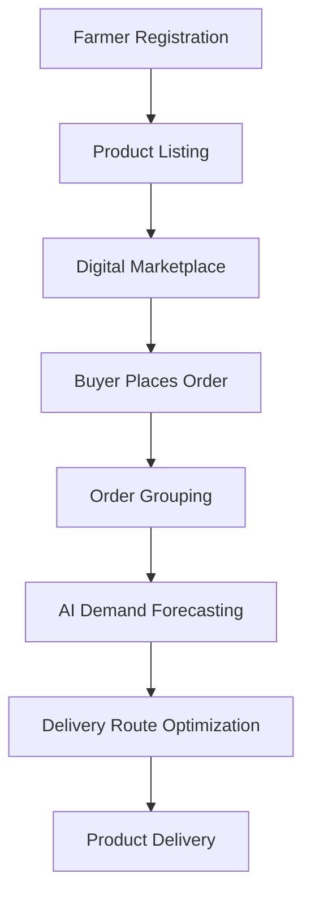

# Smart India Hackathon Workshop
# Date:30-10-2026
## Reference Number:26009620
## Name:Meduri josya sree

## Problem Title
SIH 26033: Multiple intermediaries reduce farmers earnings and increase consumer prices.

## Problem Creater's Organization
Ministry of Consumer Affairs, Food & Public Distribution

## Theme
Agriculture, FoodTech & Rural Development

## Problem Description
Expected Solution: Create a digital marketplace that:

• Connects farmers/FPOs directly with consumers and bulk buyers.
• Provides logistics support.
• Uses AI for demand forecasting and route optimization.

Benefits:

• Better prices for farmers.
• Lower prices for consumers.
• Reduced supply chain inefficiencies.

## Proposed Solution
### FarmConnect – A Smart Direct Farmer-to-Consumer Marketplace

FarmConnect is a digital platform that connects farmers directly with consumers, retailers and bulk buyers, reducing the need for multiple intermediaries.

1. Farmers can register and upload their crops, quantity and expected prices.
2. Buyers can browse available products and place orders directly.
3. A transparent pricing system helps farmers receive fair prices.
4. Group ordering allows nearby consumers to combine orders and reduce delivery costs.
5. AI-based demand forecasting helps farmers understand future market demand.
6. Smart delivery planning helps identify efficient transportation routes.

The unique feature of FarmConnect is the combination of direct selling, group ordering and AI-based delivery planning in one platform.

## Technical Approach
### Technologies Used

1. Frontend: HTML, CSS and JavaScript.
2. Backend: Python with Django.
3. Database: SQLite or MySQL.
4. AI and Machine Learning: Python libraries for demand forecasting.
5. Maps API: For location tracking and route optimization.

### Implementation Process

1. Develop registration and login facilities for farmers and buyers.
2. Create a product listing system for farmers.
3. Develop a marketplace for buyers to search and order products.
4. Implement order management and group ordering.
5. Integrate AI-based demand forecasting.
6. Add smart delivery route planning.

### System Workflow

Farmer Registration → Product Listing → Digital Marketplace → Buyer Orders → Order Grouping → Delivery Planning → Product Delivery.

## Feasibility and Viability
1. FarmConnect can be developed using affordable and easily available technologies.
2. Farmers and buyers can access the platform through smartphones or computers.
3. Limited internet connectivity in rural areas may be a challenge.
4. Some farmers may have difficulty using digital platforms.
5. These challenges can be reduced by providing a simple interface, regional language support and assistance through Farmer Producer Organizations (FPOs).
6. The platform can first be tested in selected villages and gradually expanded to other regions.

## Impact and Benefits
### Benefits for Farmers
1. Better earnings through direct selling.
2. Access to more buyers.
3. Reduced dependence on middlemen.
4. Better understanding of market demand.

### Benefits for Consumers
1. Fresh agricultural products.
2. Lower purchasing costs.
3. Transparent product pricing.
4. Direct access to farmers.

### Environmental and Social Benefits
1. Reduced unnecessary transportation.
2. Better coordination of agricultural supply chains.
3. Reduced food wastage through demand forecasting.
4. Improved opportunities for rural farmers.

## Research and References
1. e-NAM – https://enam.gov.in/
   Information about online agricultural trading.

2. AGMARKNET – https://agmarknet.gov.in/
   Information about agricultural market prices.

3. Ministry of Agriculture and Farmers Welfare – https://agriwelfare.gov.in/
   Information about agricultural development in India.

4. ONDC – https://ondc.org/
   Information about digital commerce and online marketplaces.
